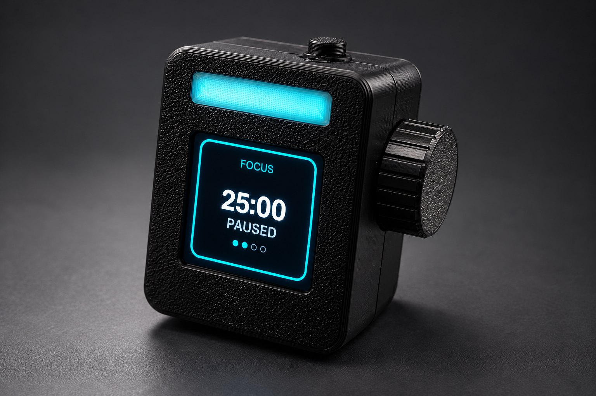
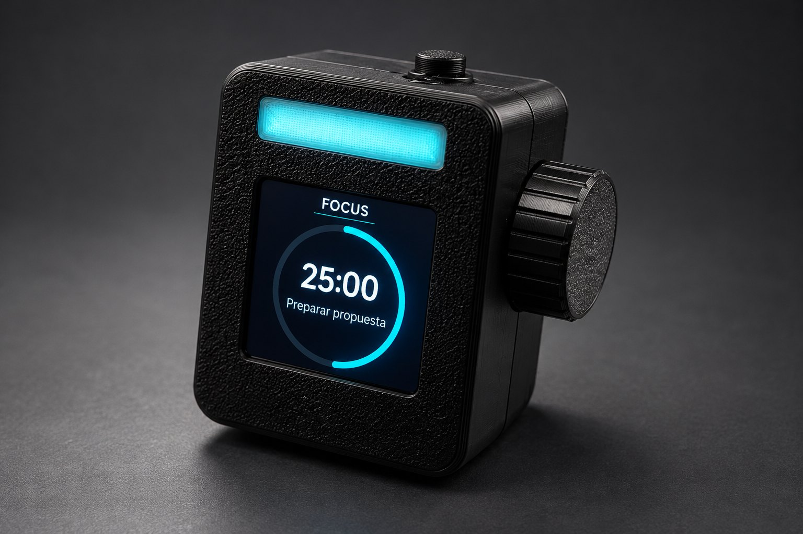
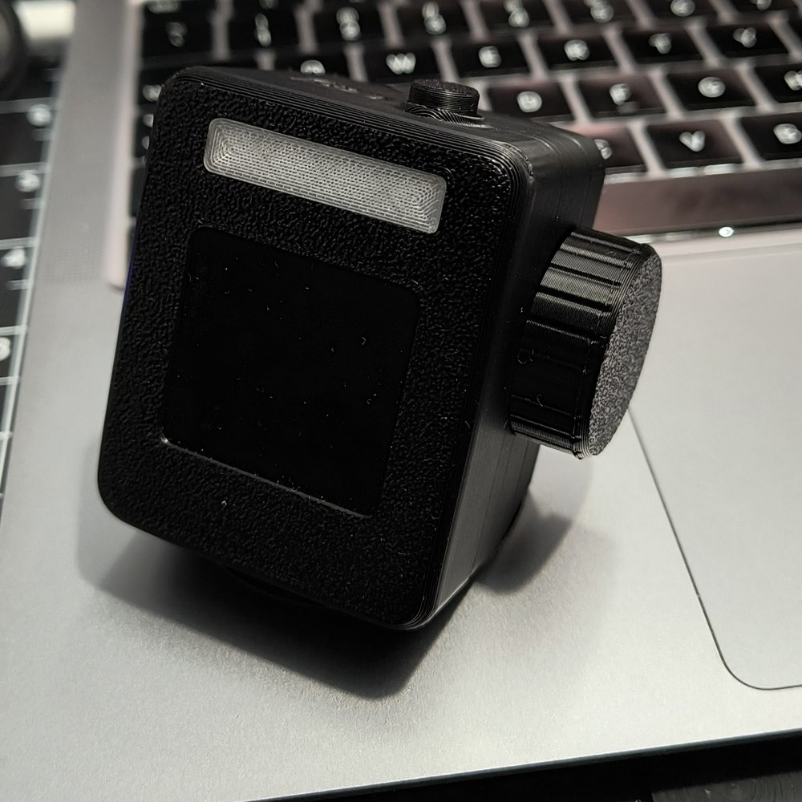
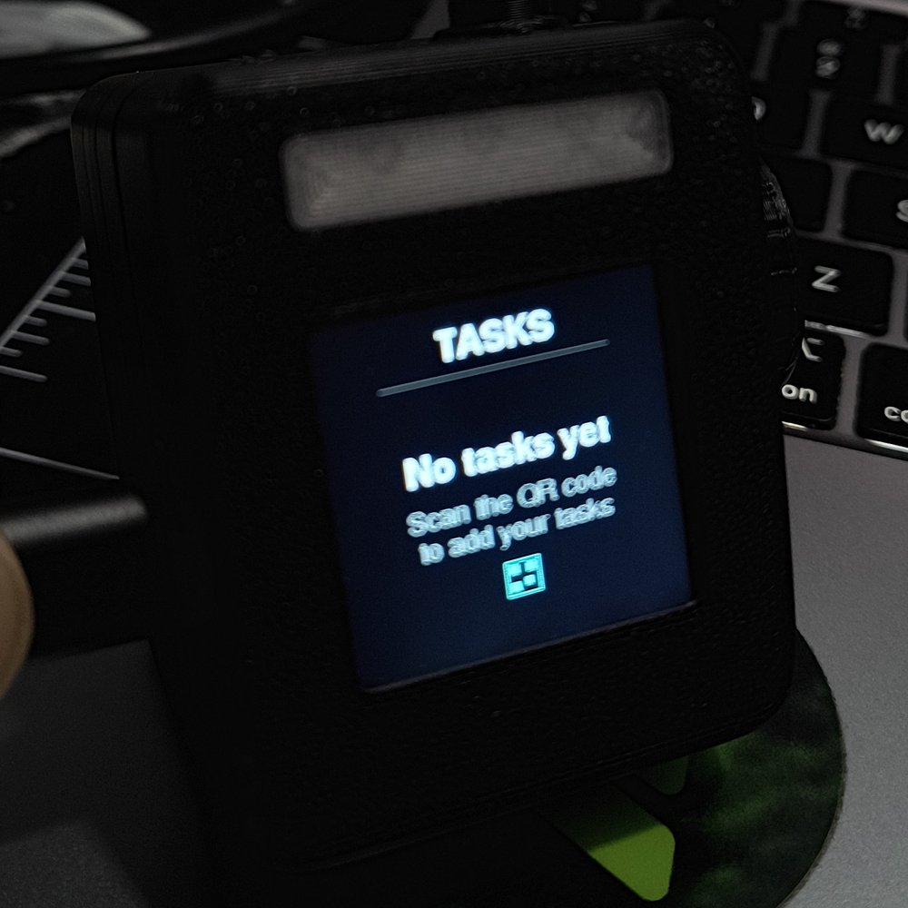
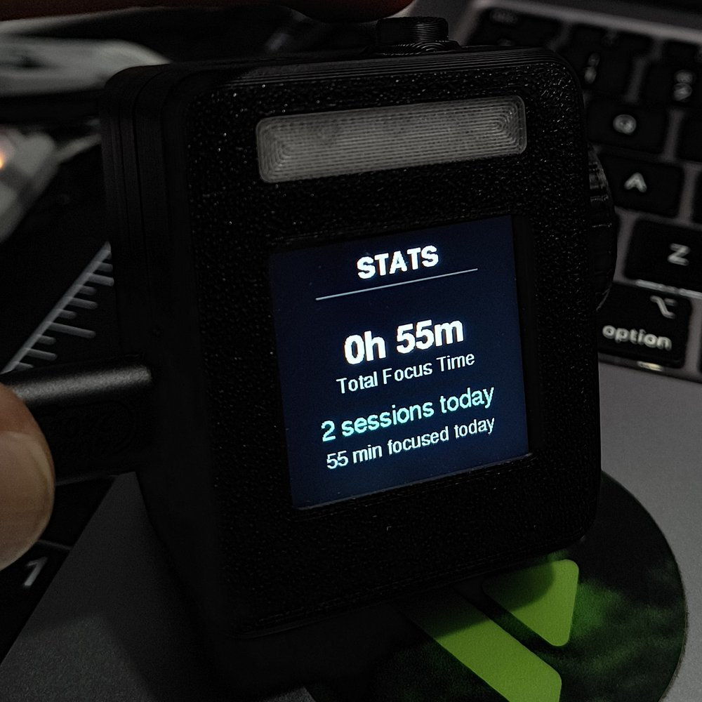
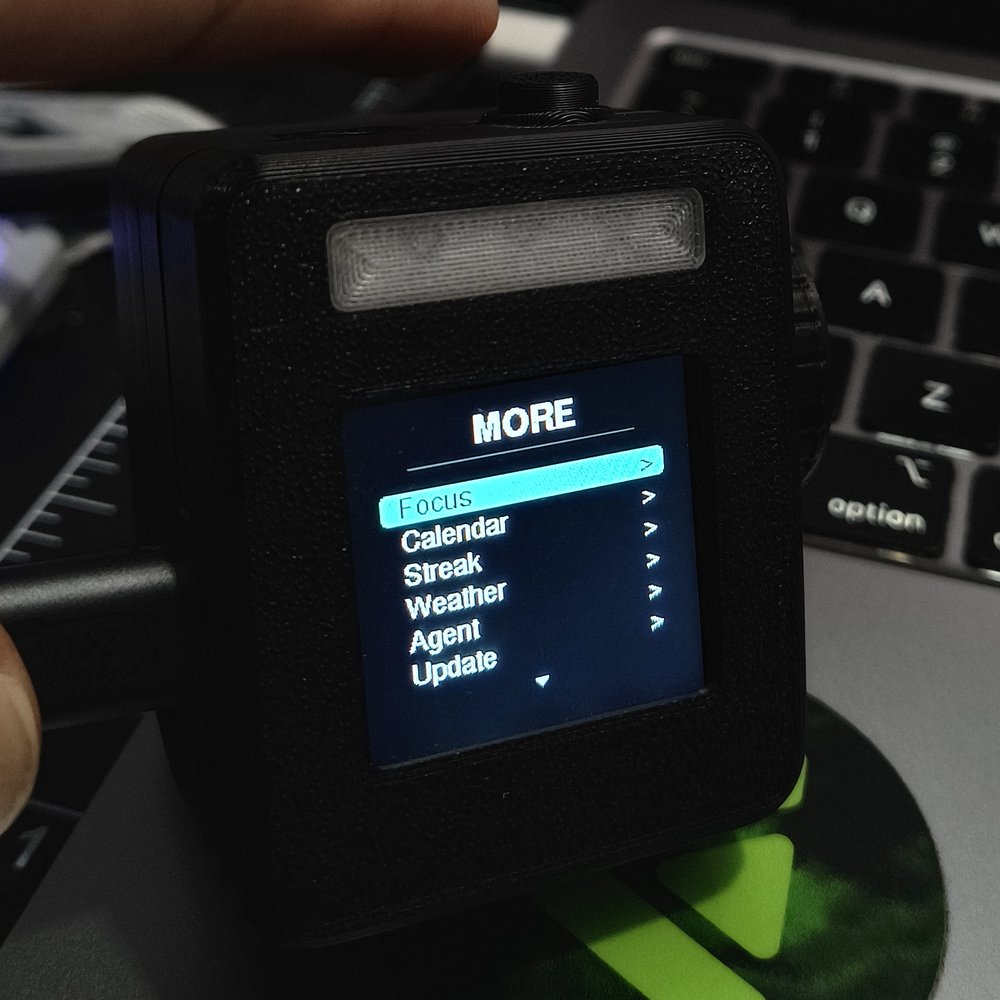
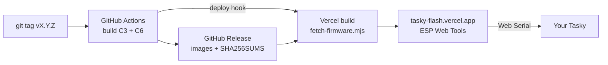

<div align="center">



# Tasky

**A tiny open-source desk companion that keeps you in focus.**<br>
A knob, a screen and a light bar: focus timer, today's tasks, your streak, your next meeting and an AI agent, without reaching for your phone.

[](https://github.com/arampersand/tasky/actions/workflows/ci.yml)
[](https://github.com/arampersand/tasky/releases/latest)
[](LICENSE)
[](docs/HARDWARE.md)

### [⚡ Flash it from your browser →](https://tasky-flash.vercel.app)

[Manual](docs/MANUAL.md) · [Hardware](docs/HARDWARE.md) · [Build](docs/BUILDING.md) · [Make your own](docs/CUSTOMIZING.md) · [Architecture](docs/ARCHITECTURE.md) · [Roadmap](docs/ROADMAP.md) · [Español](README.es.md)

</div>

---

<table>
<tr>
<td></td>
<td></td>
<td></td>
<td></td>
<td></td>
</tr>
</table>

## One firmware, everything

Since **3.0** there is a single firmware for both boards (XIAO C3 and C6) with everything: Home at a glance, focus timer, tasks, calendar, weather, GitHub streak, Notion, ask ChatGPT/Claude, **Claude Code agent cards** (the light breathes when an agent needs you, and you allow or deny permission prompts with the knob) and a **Bluetooth key row** (volume, brightness, media and shortcuts for Mac or Windows). Agents and Controls are in the MODE carousel from the start; Bluetooth only starts the first time you open Controls.

**Connect Claude Code**: in Claude Code, run

```
/plugin marketplace add arampersand/tasky
/plugin install tasky@tasky
```

then restart Claude Code; Tasky shows a *Ready* card. Something off? Run `/tasky:status`. No plugin? [The terminal installer](companion/README.md#without-the-plugin-terminal) does the same.

## Why Tasky

Your phone is the worst focus tool you own. Tasky is a single-purpose object that sits next to your keyboard. Turn the knob, click, and you're working. The light bar tells the people around you you're heads-down. Everything is open: firmware, docs and the web flasher, so you can build one from off-the-shelf parts and make it yours.

## Features

| | |
|---|---|
| ⏱ **Focus timer** | Pomodoro-style sessions with a draining progress ring, session dots and an alarm. Focus mode turns the light bar on and locks the MODE button so you stay on the timer. |
| ✅ **Tasks** | Three tasks for today. Focus minutes are tracked per task; finishing tasks feeds your streak. |
| 🔥 **Streak** | GitHub-style contribution grid fed by focus sessions and, optionally, your real GitHub contributions. |
| 📅 **Calendar & agenda** | Any iCal feed (Google, Outlook, iCloud). Meeting alert 5 minutes before, a morning brief and an end-of-day close. |
| 🌤 **Weather** | Open-Meteo, so no API key is needed. Just your city. |
| 🤖 **AI agent** | Bring your Claude or OpenAI key. |
| 🧑‍💻 **Claude Code agents** | One card per session; the light breathes when an agent waits for you; allow or deny permission prompts with the knob. |
| 🎛 **Controls** | Tasky as a Bluetooth key row: volume, brightness, media and shortcuts for Mac or Windows. |
| 📊 **Stats** | Total focus time, sessions and minutes today. |
| 🏠 **Home at a glance** | Time, weather, what's next, your open tasks and a rotating phrase. Press the knob to start focusing. |
| 🪄 **Two-minute setup** | Right after flashing, the website walks you through Wi-Fi, calendar, tasks, GitHub and AI over USB. Or scan a QR with your phone. |
| 🔄 **Updates** | Flash from the browser, or OTA over Wi-Fi (armed from the device itself for safety). |

## Flash in 60 seconds

1. Open **[tasky-flash.vercel.app](https://tasky-flash.vercel.app)** in Chrome or Edge on a computer.
2. Pick **XIAO ESP32-C3** or **C6** and plug the board in with a USB-C *data* cable. If no port shows up, hold `BOOT` while plugging in.
3. Click **Connect & flash**.
4. Keep it plugged in and follow **Set up** on the same page: Wi-Fi → calendar → tasks → GitHub → AI → weather, all over the USB cable. (No computer? On Tasky open **Settings → More → Setup (QR)** and scan the code with your phone.)

The page always serves the newest [release](https://github.com/arampersand/tasky/releases/latest) and keeps your settings when you reinstall. Prefer the command line? (full image, erases settings)

```bash
esptool.py --chip esp32c3 write_flash 0x0 tasky-xiao_c3-vX.Y.Z.bin
```

Full walkthrough: **[docs/MANUAL.md](docs/MANUAL.md#quick-start)**.

## Build one

| Part | Notes |
|---|---|
| Seeed Studio **XIAO ESP32-C3** or **ESP32-C6** | Same pinout, same firmware |
| **1.54" 240×240 ST7789** SPI IPS display | Round GC9A01A also supported |
| **Rotary encoder** with push switch | EC11-style |
| Tactile button | MODE / navigation |
| Active buzzer + LED(s) | Wired in series, light bar |
| 3D-printed enclosure | |

Pinout, wiring and variants: **[docs/HARDWARE.md](docs/HARDWARE.md)**. Building from source with PlatformIO or the Arduino IDE: **[docs/BUILDING.md](docs/BUILDING.md)**.

```bash
git clone https://github.com/arampersand/tasky && cd tasky/firmware
pio run -e xiao_c3 -t upload && pio device monitor
```

## Make your own Tasky

Tasky is meant to be forked. **[docs/CUSTOMIZING.md](docs/CUSTOMIZING.md)** walks through:

- turning features on and off (`firmware/tasky/config_features.h`) to fit flash or taste
- swapping to a round display, remapping pins, fixing panel offsets
- changing colours, texts and the Wi-Fi network name
- **adding your own screen** and **your own integration**, step by step
- **publishing your fork with its own one-click web flasher**: tag a release, import `web/` into Vercel, done

## How it fits together



```
firmware/   PlatformIO project: tasky/ sketch (UI, model, services, portal, OTA)
web/        Static landing + browser flasher (Vercel), 3D <tasky-device> model
docs/       Manual, hardware, building, customizing, architecture, improvements
```

Deep dive: **[docs/ARCHITECTURE.md](docs/ARCHITECTURE.md)**.

## Roadmap

**Tasky 3.0** merges the two 2.x firmwares (Tasky and Tasky for Agents) into one. Next up: **Tasky Go** (battery, phone notifications), more agents (Codex, Cursor) and Windows support for the companion. See **[docs/ROADMAP.md](docs/ROADMAP.md)**. Code-level fixes and good first issues live in **[docs/IMPROVEMENTS.md](docs/IMPROVEMENTS.md)**.

## Contributing

PRs welcome: new screens, integrations, enclosure designs, translations, bug fixes. Read **[CONTRIBUTING.md](CONTRIBUTING.md)** first. CI builds both boards on every PR.

## License

[GPL-3.0](LICENSE). You can use, modify and sell Tasky, but derivative firmware must stay open under the same license.

Made by [@arampersand](https://github.com/arampersand).
