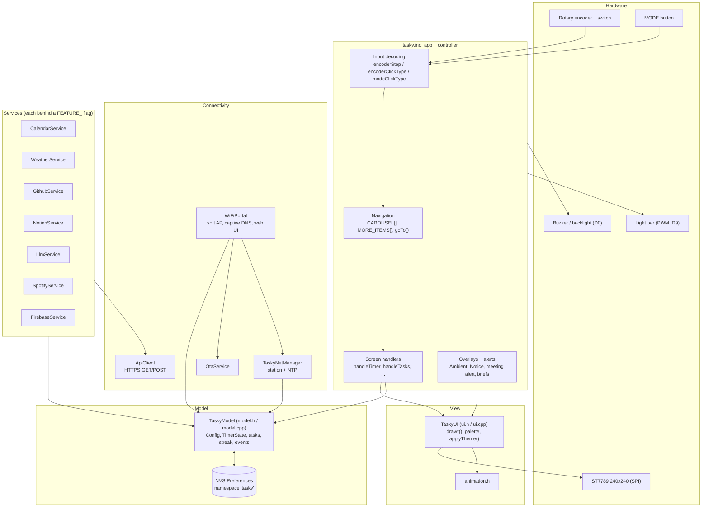
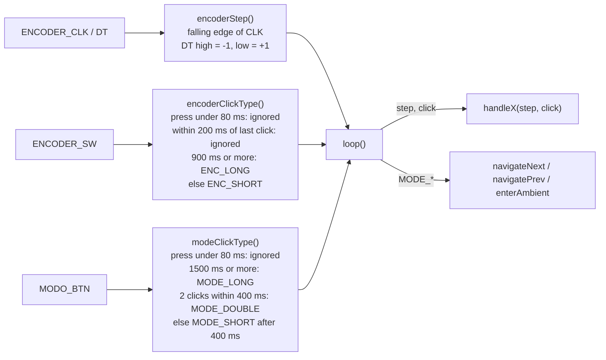
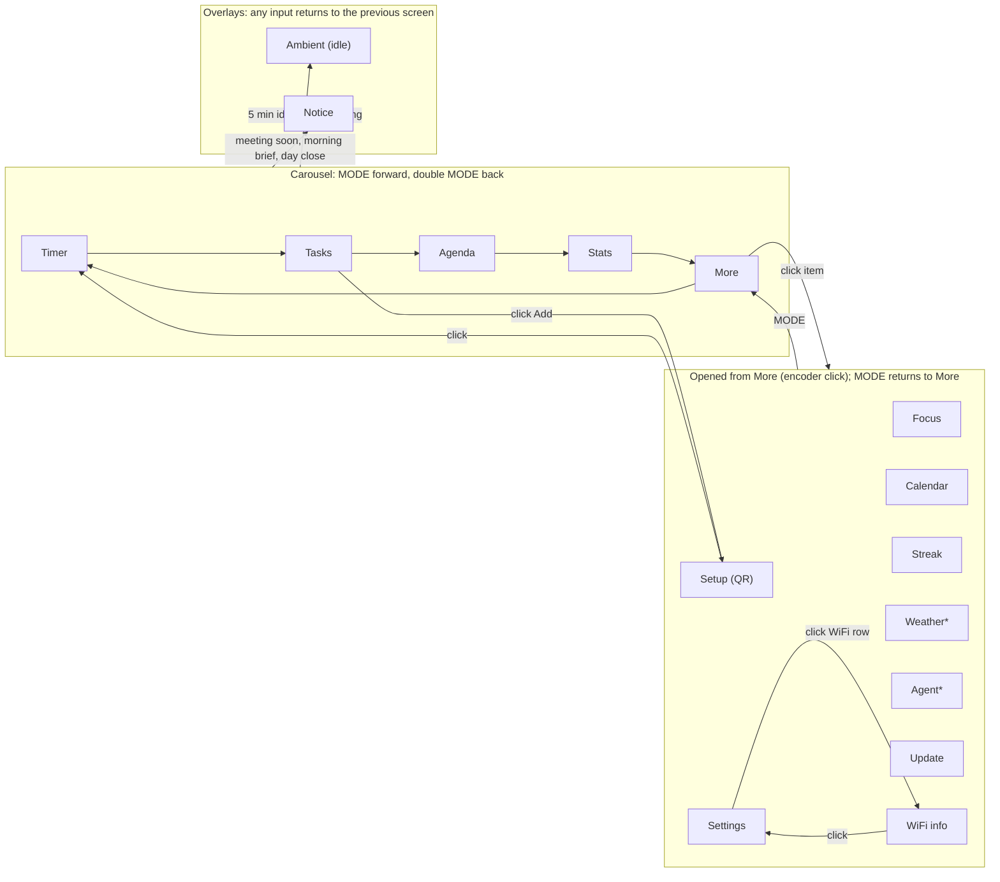
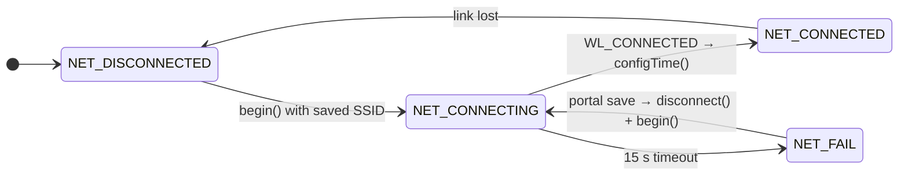
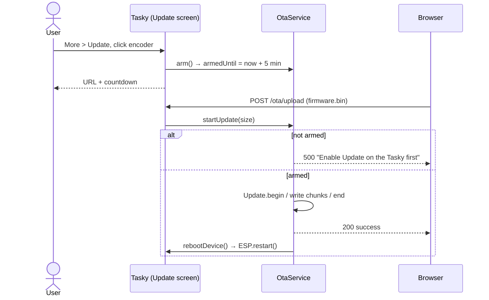
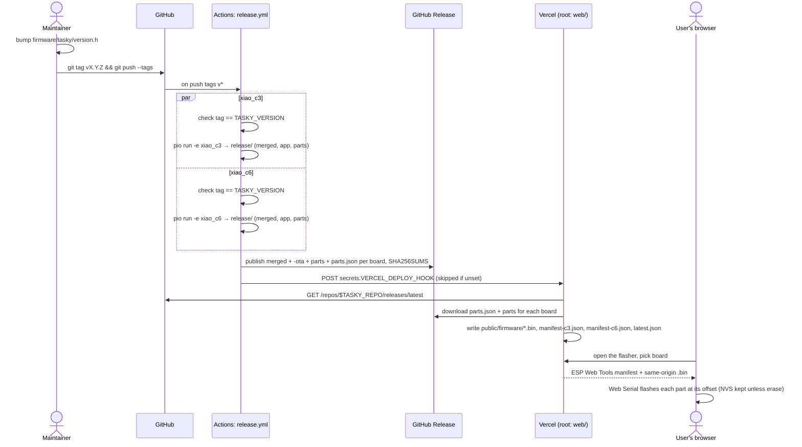

# Architecture

This document explains how the Tasky firmware is organised and how it runs: the layers, what happens at boot, how the main loop schedules work, how input becomes screen changes, what is stored where, and how a tagged commit becomes something you can flash from a browser.

Read it before you make larger changes. For step-by-step recipes (new screen, new service, fork and release) see [CUSTOMIZING.md](CUSTOMIZING.md). For build setup see [BUILDING.md](BUILDING.md).

All firmware paths are relative to `firmware/tasky/`.

## Contents

- [Layers](#layers)
- [Boot sequence](#boot-sequence)
- [Main loop timing model](#main-loop-timing-model)
- [Input pipeline](#input-pipeline)
- [Screen state machine](#screen-state-machine)
- [Persistence](#persistence)
- [Networking](#networking)
- [Services and polling](#services-and-polling)
- [OTA updates](#ota-updates)
- [Memory and flash budget](#memory-and-flash-budget)
- [Repository layout](#repository-layout)
- [Release and web flasher pipeline](#release-and-web-flasher-pipeline)

---

## Layers

Tasky is a single Arduino sketch (`tasky.ino`) plus plain C++ modules. There is no RTOS task of its own and no event bus. Everything is driven from `loop()` and talks through one shared `TaskyModel`.



| Layer | Responsibility | Rules |
|---|---|---|
| `tasky.ino` | Owns every global object, reads input, routes it to the current screen's handler, drives the buzzer and light bar, raises overlays. | The only place that knows the current `Screen`. |
| `TaskyUI` | Drawing only. Owns the `tft` object, the palette, and per-screen UI state such as selection indices and edit flags. | Reads the model; never touches the network. |
| `TaskyModel` | All persistent and shared state, timer arithmetic, streak logic, local time. | No dependency on UI, network or feature flags. |
| `TaskyNetManager`, `WiFiPortal`, `OtaService` | WiFi station, setup access point and web UI, firmware upload. | Always compiled. |
| `*_service` | One external integration each, polled on its own interval. | Fully removed when its `FEATURE_` flag is `0`. |

Configuration headers: `config_hardware.h` (pins, display size, bring-up switches), `config_features.h` (feature flags, `TASKY_MODE_DEV`, secret fallbacks), `version.h` (`TASKY_VERSION`, the single source of truth for releases).

---

## Boot sequence

`setup()` in `tasky.ino`, in order:

| # | Step | Code | Time |
|---|---|---|---|
| 1 | Let power settle, open serial at 115200, print pins and free heap | `delay(500)`, `Serial.begin()` | ~1 s |
| 2 | Start SPI on `TFT_SCK` / `TFT_MOSI` | `SPI.begin(...)` | |
| 3 | Inputs as `INPUT_PULLUP`; buzzer and backlight as outputs; backlight on | `pinMode(...)` | |
| 4 | Attach LEDC PWM to the light bar (5 kHz, 8 bit) | `ledcAttach(LED_PIN, 5000, 8)` | |
| 5 | Short boot chirp | `buzzerTone(1000)` | 50 ms |
| 6 | Optional display bring-up loop (never returns) | `#if DISPLAY_BRINGUP` | |
| 7 | Load all settings and state from NVS, then apply `config_secrets.h` fallbacks | `model.begin()` → `load()` | |
| 8 | Hardware reset of the panel, init, rotation 2, inversion, theme | `ui.init()` | ~0.5 s |
| 9 | Backlight to the saved brightness, splash screen | `ui.drawSplashTasky()` | 1.3 s |
| 10 | Start a WiFi station connection if an SSID is saved (non-blocking) | `net.begin()` | |
| 11 | `begin()` on every compiled service, then `ota.begin()` | `#if FEATURE_...` | |
| 12 | Build the More menu labels, reset the idle timer, show the Timer screen | `moreLabels[]`, `screen = SCR_TIMER` | |

The setup access point is **not** started at boot (see [Networking](#networking)).

---

## Main loop timing model

`loop()` never sleeps. Every subsystem is time-sliced with `millis()` deltas, so one iteration takes well under a millisecond when there is no network I/O and the device stays responsive. Each periodic task follows the same pattern:

```cpp
static uint32_t lastServiceCheck = 0;
if (now - lastServiceCheck > 5000) {
  lastServiceCheck = now;
  // ... work ...
}
```

Unsigned subtraction makes this safe across the 49-day `millis()` wrap-around.

One `loop()` iteration, top to bottom:

| Order | What | Cadence |
|---|---|---|
| 1 | `yield()`; `portal.loop()` (DNS and HTTP, only if the AP is on); `net.loop()` (station state machine and NTP check) | every iteration |
| 2 | Re-assert backlight (shared with the buzzer pin) | every 2 s |
| 3 | `loop()` on every service, `model.checkDayChange()`, `checkMeetingAlert()`, `checkDayBriefs()` | every 5 s |
| 4 | Focus light bar on or off | every 250 ms |
| 5 | Turn off the UI click beep when it is due | when `uiBeepOffAt` passes |
| 6 | **Read input once**: MODE, encoder step, encoder click | every iteration |
| 7 | Both buttons held for 3 s → factory reset | every iteration |
| 8 | Overlays (Notice, Ambient) take the input and `return` | |
| 9 | Focus lock, idle timeout (5 min), MODE navigation | |
| 10 | `switch (screen)` → `handleX(step, click)` | every iteration |

Inside handlers, redraws are rate-limited the same way. The timer checks its digits every 250 ms and only redraws when the second changes. The Update screen counts down once per second. The Agent animation refreshes every 400 ms.

**Known blocking spots.** These are deliberate, and not to be copied into new code:

- `setup()` and `ui.init()` use short `delay()`s for power and panel reset.
- HTTP requests in services are synchronous (`HTTPClient`), so the UI freezes for the length of a request. That is why services poll rarely and request small payloads.
- `handleAgent()` uses `delay(800)` for its "thinking" animation before the request.
- Factory reset and the post-OTA reboot use `delay(500)` before `ESP.restart()`.

---

## Input pipeline

All inputs are active-low with internal pull-ups and are **polled** (no interrupts). The three decoders run exactly once per loop, and their results are passed to handlers as values, so no handler reads a GPIO itself.



Details that matter when you add features:

- **Clicks fire on release**, so a long press is only known when the button comes up.
- **MODE short press is delayed by 400 ms**, the window for a possible double press. Single presses that need to feel instant belong on the encoder.
- **Any input resets the idle timer** (`lastInputAt`).
- **Both buttons held for 3 s** clears the whole `tasky` NVS namespace and restarts. This check reads the GPIOs directly, because it needs the "held" state rather than click events.

| Gesture | Effect |
|---|---|
| Turn encoder | `step` = -1 / +1 to the current handler |
| Click / long click encoder | `ENC_SHORT` / `ENC_LONG` to the current handler |
| MODE | next screen in the carousel; from a More sub-screen, back to More |
| MODE double | previous screen in the carousel; from a More sub-screen, back to More |
| MODE long (1.5 s) | idle (Ambient) screen, if no session is running |
| Encoder + MODE for 3 s | factory reset |

---

## Screen state machine

`Screen` (in `ui.h`) is the single state variable, `screen`, owned by `tasky.ino`. Changing it goes through `goTo()`, which resets `ui.baseDrawn` (so the next handler call repaints everything), clears edit flags, re-applies the theme and, for `SCR_QR`, `SCR_WIFI_INFO` and `SCR_UPDATE`, starts the setup access point.



\* Only present when the matching `FEATURE_` flag is on.

- **Carousel**: `CAROUSEL[] = {SCR_TIMER, SCR_TASKS, SCR_AGENDA, SCR_STATS, SCR_MORE}`. MODE moves forward, double MODE moves back, and both wrap around.
- **More**: `MORE_ITEMS[]` maps labels to screens. Items whose module is compiled out (Weather, Agent, Music) disappear from the table at compile time.
- **Overlays**: `SCR_AMBIENT` and `SCR_NOTICE` save the current screen in `screenBeforeOverlay` and return to it on any input. Notices never interrupt the Update screen, and briefs never interrupt a running session.
- **Idle is suppressed** while a session is running or finished, and on Update, Setup (QR) and WiFi info, which need to stay on screen.
- **Focus lock**: while a work session runs with `focusLock` on, MODE on the Timer is swallowed and the task line shows "Pause to unlock".

Each handler follows the same contract:

```cpp
void handleX(int step, EncClickType click) {
  if (!ui.baseDrawn) {        // first call after goTo(): full repaint
    ui.drawX();
    ui.baseDrawn = true;
  }
  if (step != 0)  { /* change selection or value, partial redraw */ }
  if (click == ENC_SHORT) { ui.uiTick(true); /* act, model.save() if persistent */ }
}
```

---

## Persistence

Everything persistent lives in ESP32 NVS through Arduino `Preferences`, namespace **`tasky`**. `TaskyModel::load()` reads every key once at boot. `TaskyModel::save()` writes **every** key. It is called after user actions (settings, task toggles, timer start) and after portal saves, never on a timer.

> [!IMPORTANT]
> NVS keys are limited to **15 characters**. Keep new keys short and unique, and keep the default value in `load()` consistent with the `Config` initializer in `model.h`.

| Key | Type | Field | Default |
|---|---|---|---|
| `work` / `break` | u8 | `cfg.workMin` / `cfg.breakMin` | 25 / 5 |
| `bl` / `led` | u8 | `cfg.screenBright` / `cfg.ledBright` | 200 / 180 |
| `snd` / `dark` | bool | `cfg.soundOn` / `cfg.darkMode` | true / true |
| `focus` | u32 | `cfg.totalFocusMin` | 0 |
| `best` | u16 | `cfg.bestStreak` | 0 |
| `wss` / `wps` | string | `cfg.wifiSSID` / `cfg.wifiPass` | "" |
| `tz` | i8 | `cfg.timezone` (UTC offset, hours) | -5 |
| `ghu` / `ght` | string | `cfg.githubUser` / `cfg.githubToken` | "" |
| `cal` | string | `cfg.calendarUrl` | "" |
| `nkey` / `ndb` | string | `cfg.notionApiKey` / `cfg.notionDatabaseId` | "" |
| `fAuto` / `fLit` / `fLck` | bool | `cfg.focusAutoMode` / `focusLight` / `focusLock` | true |
| `dsh` / `deh` | u8 | `cfg.dayStartHour` / `cfg.dayEndHour` | 9 / 18 |
| `bmd` / `bed` | i16 | `cfg.lastMorningDay` / `lastEveningDay` (`tm_yday`) | -1 |
| `sks` | u8 | `cfg.streakSource` (0 GitHub, 1 Tasky, 2 both) | 2 |
| `dpc` / `ypc` | u8 | `cfg.dailyPomodoroCount` / `yesterdayPomodoro` | 0 |
| `dfm` | u16 | `cfg.dailyFocusMin` | 0 |
| `ghc` | u8 | `cfg.githubContribCount` | 0 |
| `fbUrl` / `fbKey` / `fbOn` | string / string / bool | Firebase URL, secret, enabled | "" / "" / false |
| `wCity` / `wCel` | string / bool | `cfg.weatherCity` / `cfg.weatherCelsius` | "" / true |
| `wLat` / `wLon` | float | `cfg.weatherLat` / `cfg.weatherLon` | 0 |
| `spId` / `spSec` / `spTok` / `spRef` | string | Spotify client ID, secret, access token, refresh token | "" |
| `lKey` | string | `cfg.llmApiKey` | "" |
| `lPrv` | u8 | `cfg.llmProvider` (0 Anthropic, 1 OpenAI) | 0 |
| `lMod` | i8 | `cfg.llmModeOverride` (-1 auto) | -1 |
| `t0`..`t2` | string | `tasks[i]` | "Empty" |
| `d0`..`d2` | bool | `taskDone[i]` | false |
| `td0`..`td2` | string | `taskDescription[i]` | "" |
| `tf0`..`tf2` | u16 | `taskFocusMin[i]` | 0 |
| `ct` | i8 | `currentTask` (-1 none) | -1 |
| `s0`..`s83` | u8 | `streak[i]`, intensity 0 to 3 (6 x 14 grid) | 0 |
| `day` | u8 | `currentDayIndex` | 0 |
| `ch` / `cm` / `cs` | u8 | fallback clock h/m/s | 12 / 0 / 0 |

Not persisted, rebuilt at runtime: calendar events (`calendarEvents`, `todayEvents`, `monthEvents`), Notion tasks, weather data, timer state, and LLM request counters (`llmDailyCount`, `llmHourlyCount`).

`config_secrets.h` values are applied in `load()` **only when the matching NVS value is empty**, so portal settings always win.

---

## Networking

Two independent pieces share the radio in `WIFI_AP_STA` mode.

### Station (`TaskyNetManager`)



- `begin()` runs at boot and after every portal save. If no SSID is saved, it stays `NET_DISCONNECTED`.
- Everything is polled from `net.loop()`. Nothing blocks.
- **NTP**: on connect, `configTime(timezone * 3600, 0, "pool.ntp.org", "time.nist.gov")`. `checkTimeSync()` then polls `time()` until it returns a date after 2020, giving up after 10 s. The timezone is a whole-hour UTC offset with no DST rules. `TaskyModel::localNow()` returns `false` until the time is valid, and every time-based feature (meeting alerts, briefs, ambient clock) checks it.

### Setup access point (`WiFiPortal`)

- **Started lazily**, only when the user opens **Setup (QR)**, **Settings > WiFi**, or **Update**, or picks "Add" in Tasks. A device that never needs setup never broadcasts an AP (the station connection uses `WIFI_STA` unless the portal is up). It stays up while a setup screen is open, a phone is connected or an OTA is armed, and `portal.loop()` stops it after `IDLE_STOP_MS` (10 min) of inactivity, falling back to `WIFI_STA`. Secret fields are write-only and every reflected value is HTML-escaped.
- SSID `Tasky`, WPA2 password `cfg.apPass`: 10 random characters generated on first boot (`TaskyModel::begin()`, NVS key `app`), shown on the QR/WiFi/Update screens and regenerated by a factory reset. Default IP `192.168.4.1`.
- **Access control:** clients on the setup AP are trusted (they could only learn the password from the device). Clients on the home LAN need HTTP Basic auth (`tasky` + the AP password), the `Host` header must be the device IP (DNS rebinding), and `Origin`/`Referer`, when present, must match it (CSRF).
- A captive DNS server (`dns.start(53, "*", ip)`) resolves every hostname to the device, and the OS connectivity probes (`/generate_204`, `/hotspot-detect.html`, `/ncsi.txt`, ...) are answered so phones open the portal automatically.

| Route | Purpose |
|---|---|
| `GET /` | Settings page (`htmlPage()`); sections compiled per feature flag and `TASKY_MODE_DEV` |
| `POST /save` | `handleSave()`: update `cfg`, `model.save()`, reconnect the station |
| `GET /ota/status` | JSON: state, progress, version, error |
| `POST /ota/upload` | Multipart firmware upload, streamed into `OtaService` |
| `GET /ping` | `pong` |
| anything else | 302 to the portal root |

The same web server answers on the station IP when Tasky is on your network, which is how the Update screen can show `http://<device-ip>/`.

---

## Services and polling

Every service exposes `begin()`, `loop()` and usually `forceUpdate()`, and receives the shared `TaskyModel *`. `loop()` is called every **5 s** from the main loop and decides by itself whether it is time to fetch. HTTPS goes through `ApiClient` (`api_client.h`), which returns `""` / `false` immediately when WiFi is down. Certificate validation is off (`setInsecure()`).

| Service | Flag | Source | Interval | Writes to |
|---|---|---|---|---|
| `CalendarService` | `FEATURE_CALENDAR` | Secret iCal URL, streamed line by line (`getStreaming`), RRULE expansion | 10 s after boot, then 15 min | `model.calendarEvents`, `todayEvents`, `monthEvents` |
| `WeatherService` | `FEATURE_WEATHER` | Open-Meteo geocoding + forecast (no key) | 10 s after boot, then 30 min; retry after 30 s on failure | own fields (`temperature`, `icon`, ...); `cfg.weatherLat/Lon` after geocoding |
| `GithubService` | `FEATURE_GITHUB` | GitHub contributions | 10 s after boot, then 30 min | `cfg.githubContribCount`, `model.streak[]` (according to `streakSource`) |
| `NotionService` | `FEATURE_NOTION` | Notion database query | every 10 min; the first fetch is 10 min after boot unless you click Agenda | `model.notionTasks` |
| `LlmService` | `FEATURE_LLM` | Anthropic or OpenAI, **on demand** from the Agent screen | `loop()` only resets the hourly counter; capped at 20 requests per hour and 100 per day | own `response` buffer |
| `SpotifyService` | `FEATURE_SPOTIFY` | Spotify Web API | 5 s | own `playback` |
| `FirebaseService` | `FEATURE_FIREBASE` | Firebase Realtime DB | 15 min; 2 min retry | remote |

Screens can force a refresh. A click on Agenda calls `calendar.forceUpdate()` and `notion.forceUpdate()`, and a click on Weather calls `weather.forceUpdate()`.

JSON is parsed with small `indexOf()`/`substring()` helpers rather than a JSON library, to save flash.

---

## OTA updates

Firmware can be updated over WiFi from the portal. Uploads are only accepted after someone **physically confirms on the device**, so nobody on the same network can flash it silently.



- `ARM_WINDOW_MS = 5 min` (`ota_service.h`). Clicking again disarms. `isArmed()` is wrap-safe.
- The upload must be the **app-only** image (`.pio/build/<env>/firmware.bin`, `.bin` extension enforced). It is written to the inactive OTA slot, and the bootloader switches slots after a successful `Update.end()`.
- `OtaService::getVersion()` reports `TASKY_VERSION` from `version.h`. It appears on the Update screen and in `/ota/status`.

---

## Memory and flash budget

Partition table: `min_spiffs.csv` (set in `platformio.ini`), with two app slots of **1.875 MB** (1,966,080 bytes) each for OTA, plus a small SPIFFS region that Tasky does not use.

Measured from a v2.4.0 default build (pioarduino, Arduino-ESP32 core 3.3.3):

| | XIAO ESP32-C3 | XIAO ESP32-C6 |
|---|---|---|
| App image (`firmware.bin`) | 1,611,200 B (~1.54 MiB, **82 %** of slot) | 1,619,888 B (~1.54 MiB, **82 %** of slot) |
| Merged image (release asset) | 1,676,736 B | 1,685,424 B |
| Static RAM (`.dram0.data` + `.dram0.bss`) | 12.8 KB + 35.1 KB = **~48 KB** | 14.9 KB + 39.9 KB = **~55 KB** |

The C3 has 400 KB of SRAM in total. After WiFi, TLS and the static data, the free heap printed at boot (`Free heap: ...`) is what is left for HTTPS buffers and `String`s. To protect it:

- Fixed-size structs with `char[]` fields for events and tasks (`CalendarEventItem`, `NotionTaskItem`) and fixed caps (`MAX_TODAY_EVENTS 5`, `MAX_MONTH_EVENTS 20`, `MAX_NOTION_TASKS 5`).
- iCal is streamed line by line instead of loaded whole.
- LLM responses are capped (`LLM_RESPONSE_MAX 256`).
- No framebuffer: the UI draws straight to the panel and redraws only the regions that changed.

Room to grow is roughly **340 KB of flash** before the OTA slot is full. Check the size of every feature you add (see [CUSTOMIZING.md](CUSTOMIZING.md#flash-size-impact)).

---

## Repository layout

```text
tasky/
├── README.md, README.es.md       Overview, flash-in-60-seconds
├── LICENSE                       GPL-3.0
├── CONTRIBUTING.md, CHANGELOG.md
├── docs/
│   ├── MANUAL.md                 Using the device
│   ├── HARDWARE.md               BOM, wiring, enclosure
│   ├── BUILDING.md               Toolchain, build, flash
│   ├── CUSTOMIZING.md            Make your own Tasky
│   ├── ARCHITECTURE.md           This file
│   ├── IMPROVEMENTS.md           Known debt and ideas
│   └── images/
├── firmware/
│   ├── platformio.ini            envs xiao_c3, xiao_c6 (pioarduino)
│   ├── scripts/merge_bin.py      post-build: single image at 0x0
│   └── tasky/
│       ├── tasky.ino             setup(), loop(), input, navigation, handlers
│       ├── ui.h / ui.cpp         TaskyUI: Screen enum, palette, draw*()
│       ├── animation.h           lightweight UI animations
│       ├── model.h / model.cpp   TaskyModel: Config, timer, streak, NVS
│       ├── network_manager.*     WiFi station + NTP
│       ├── wifi_portal.*         soft AP, captive DNS, settings page, OTA routes
│       ├── ota_service.*         armed OTA writer
│       ├── api_client.*          HTTPS GET / streaming GET / POST
│       ├── calendar_service.*    iCal
│       ├── weather_service.*     Open-Meteo
│       ├── github_service.*      contributions
│       ├── notion_service.*      Notion tasks
│       ├── llm_service.*         AI agent
│       ├── spotify_service.*     (experimental, off)
│       ├── firebase_service.*    (experimental, off)
│       ├── qrcode.h, qrcodegen.* QR rendering
│       ├── config_hardware.h     pins, display size, bring-up
│       ├── config_features.h     FEATURE_ flags, TASKY_MODE_DEV
│       ├── config_secrets.h.example
│       └── version.h             TASKY_VERSION
├── web/                          browser flasher (Vercel)
│   ├── vercel.json, package.json
│   ├── scripts/fetch-firmware.mjs   pulls latest Release at build time
│   └── public/                   index.html, app.js, styles.css, device/ (3D model)
└── .github/
    ├── workflows/ci.yml          build matrix on push / PR
    ├── workflows/release.yml     tag v* → GitHub Release → Vercel hook
    ├── ISSUE_TEMPLATE/
    └── PULL_REQUEST_TEMPLATE.md
```

---

## Release and web flasher pipeline



- `ci.yml` builds both environments on every push to `main` and every pull request that touches `firmware/`, and uploads the merged images as workflow artifacts.
- `merge_bin.py` runs after every build and writes `.pio/build/<env>/release/`: the merged image (`esptool merge-bin`), the app-only image, the individual parts and `tasky-<env>-parts.json` with their offsets. The flasher uses the parts rather than the merged image because the merged image fills the NVS gap with `0xFF` and would wipe settings.
- The flasher downloads the binaries **at build time** because GitHub release assets are served without CORS headers. Web Serial in the browser needs them from the same origin.
- With no Release published yet, `fetch-firmware.mjs` writes `{ "version": null }` and the page shows "No release yet".
