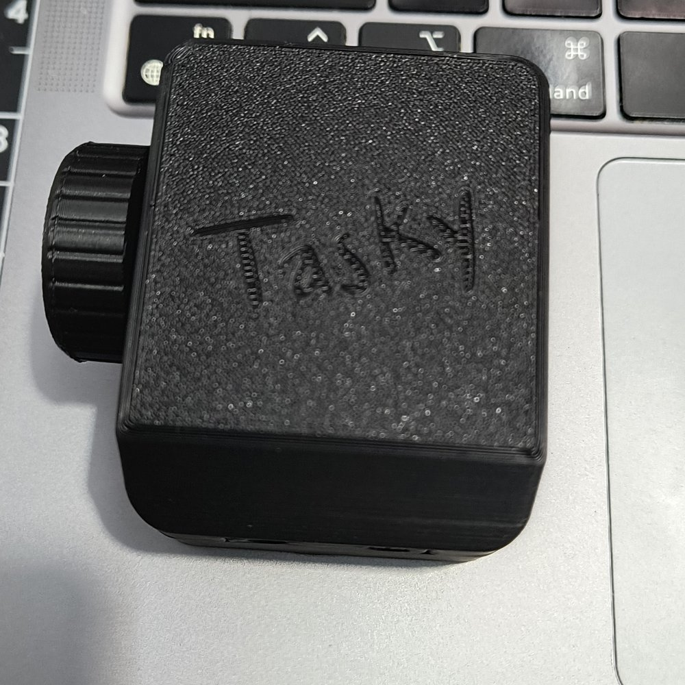
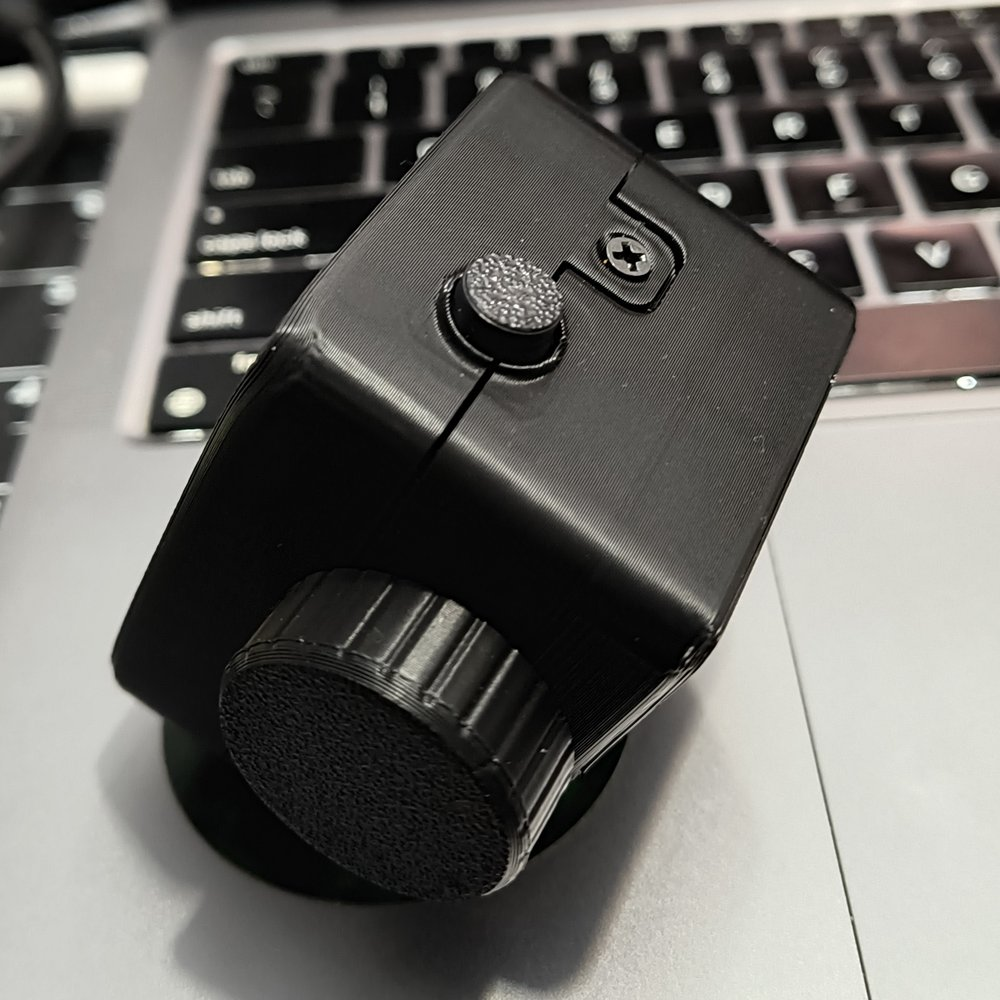
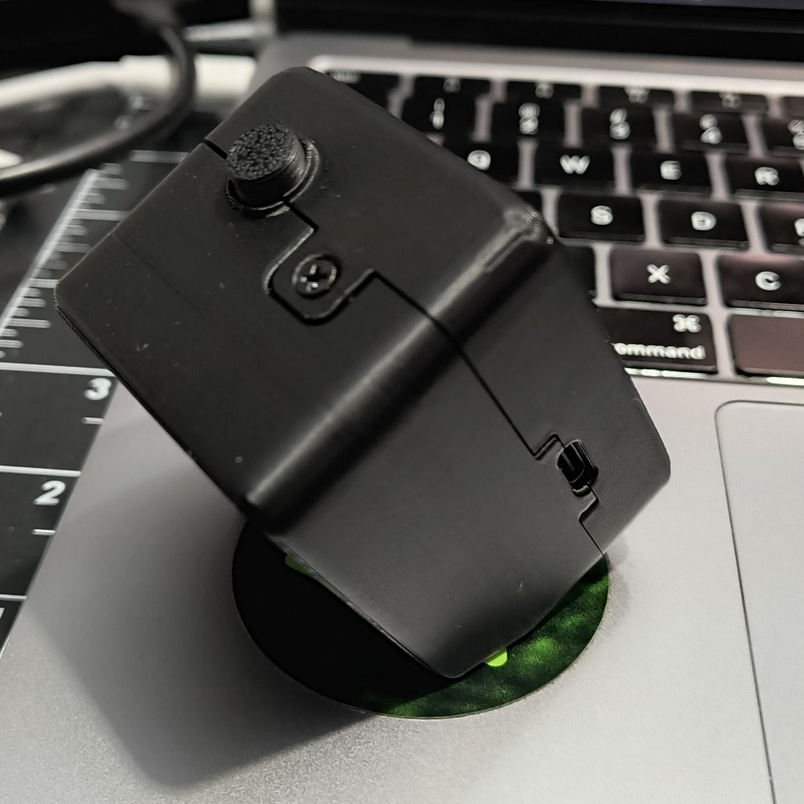
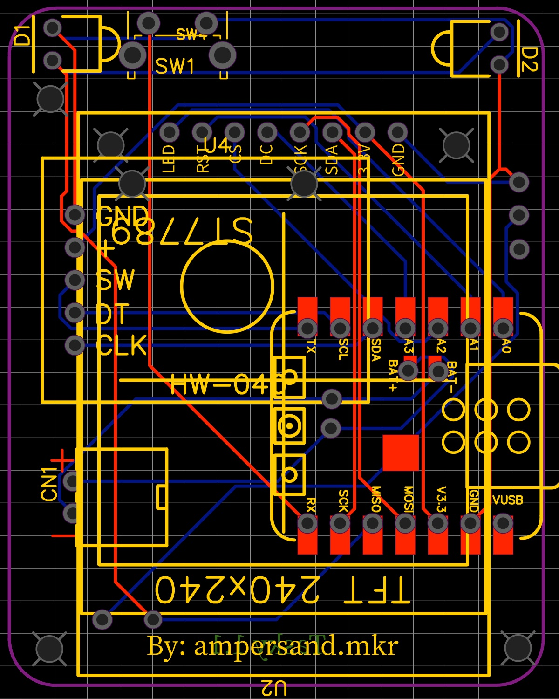
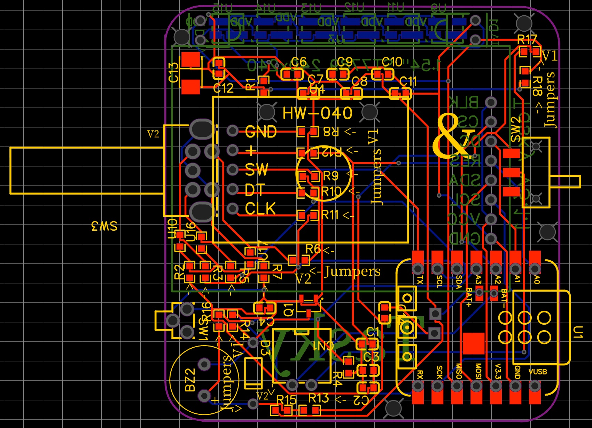
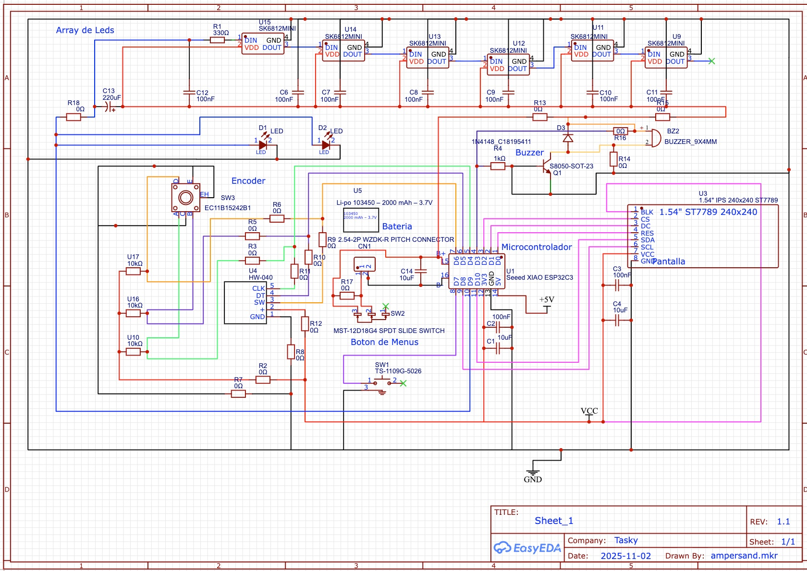

# Tasky Hardware

This guide covers the parts, pinout, wiring and display options for the reference Tasky build. The pin assignments are taken from [`firmware/tasky/config_hardware.h`](../firmware/tasky/config_hardware.h). If this guide and that file ever disagree, the file is correct.

<p>
  
  
  
</p>

---

## Bill of materials

| Qty | Part | Notes |
| --- | ---- | ----- |
| 1 | **Seeed Studio XIAO ESP32-C3** *or* **XIAO ESP32-C6** | The firmware uses XIAO `D0`–`D10` names, so the same pin map works on both. Choose the matching build environment (`xiao_c3` / `xiao_c6`) |
| 1 | **1.54" 240×240 IPS TFT, ST7789, SPI** | 7-pin type (GND, VCC, SCL, SDA, RES, DC, CS) plus BL if your module has it. Runs at 3.3 V |
| 1 | **EC11-style rotary encoder with push switch** | Provides the knob (CLK, DT, SW). Plus a knob cap |
| 1 | **Tactile push button** | The **MODE** button |
| 0–1 | **Active buzzer**, 3.3 V-compatible (optional) | Active = it beeps when DC is applied (the firmware's `ACTIVE_BUZZER 1`). Current builds leave it out: the light alone signals |
| 1+ | **LED(s)** behind a frosted diffuser | The light bar: a plain LED, or SK6812/WS2812-type RGB LEDs (just 3 wires: +, GND and data on D9; pick *RGB* in the web setup). Early builds wired it in series with a buzzer (see [Buzzer and light bar](#buzzer-and-light-bar)) |
| 1 | **USB-C cable (data-capable)** | Power and flashing. Charge-only cables won't flash |
| 1 | **3D-printed enclosure** with a frosted light-bar window and knob | **The STL files are not in the repository yet** |
| – | Hookup wire, solder, small screws | |

---

## Boards (PCB)

Tasky has a custom carrier PCB designed in EasyEDA. The XIAO, the display and the knob plug into it, so you don't need to hand-wire anything. One schematic (rev 1.1) covers both boards. 0 Ω jumpers pick which parts are fitted.

<p>
  
  
</p>

| | **v1.1** (current) | **v3.1** (modular, for manufacturing) |
| --- | --- | --- |
| Knob | HW-040 encoder module | HW-040 module **or** a bare EC11 encoder (SW3) with 10 kΩ pull-ups, chosen with jumpers (V1 = R8–R12, V2 = R2, R3, R5–R7) |
| Light | One or two plain LEDs (D1, D2) on D9 | Bar of **6 SK6812MINI RGB LEDs** on D9 (330 Ω on DIN, 100 nF per LED, 220 µF bulk) |
| Buzzer | Not on the board | 9×4 mm buzzer (BZ2) driven by an S8050 NPN (1 kΩ base resistor) with a 1N4148 flyback diode |
| Battery | 2-pin connector (CN1) to the XIAO `BAT+`/`BAT−` pads | Same, plus an SPDT slide switch (SW2) |
| MODE button | SW1 | SW1 (TS-1109G) |
| Display | 1.54" ST7789 240×240 | Same, BLK tied to VCC (always on) |

**Set the light type after flashing.** The firmware can't detect which light is fitted. The web setup has a **Light** step: *One or two LEDs* (PWM, default) or *RGB bar (6 LEDs)* (SK6812). The light blinks once when you save. The setting is stored as `ledType` in NVS. The color and LED count are `RGB_LED_COLOR` / `RGB_LED_COUNT` in `config_hardware.h`.

<details>
<summary>Schematic (rev 1.1)</summary>



</details>

**Board notes**
- **Battery:** the XIAO C3/C6 charge a single-cell LiPo on `BAT+`/`BAT−` from USB-C. The reference cell is a 103450 (2000 mAh, 3.7 V) on a 2.54 mm 2-pin connector. Neither board can measure the battery yet: there is no divider into an ADC pin (see [Tasky Go](ROADMAP.md#phase-4--tasky-go)). The firmware has no sleep mode yet: with Wi-Fi and the screen always on, a 2000 mAh cell should last roughly 15 hours (estimate, not measured).
- **SK6812MINI supply:** the LED rail is chosen with 0 Ω jumpers (R13/R15). The SK6812MINI is rated 3.7–5.5 V, so feed it from the battery/5 V side rather than 3V3 when you can. On 3.3 V it usually works, but blue and white look dim. The default amber color uses mostly red and green.
- **D9 on the C3 (v1.1):** D9 is the BOOT strapping pin. A red/yellow LED straight from D9 to GND clamps the pin to about 2 V at reset, which can start the C3 in download mode. If a C3 board won't boot, add a series resistor, use LEDs with a higher forward voltage (white/blue), or use a C6.

---

## Pinout

The XIAO **D-pin** in the first column is what `config_hardware.h` uses. The GPIO columns give the chip pin behind it on each board, taken from the arduino-esp32 3.3.x board variants.

| Function | Macro | XIAO pin | GPIO (C3) | GPIO (C6) |
| -------- | ----- | -------- | --------- | --------- |
| Buzzer | `BUZZER_PIN` | **D0** | 2 | 0 |
| Display backlight | `TFT_BL` | **D0** (shared with buzzer, see below) | 2 | 0 |
| Display chip select | `TFT_CS` | **D1** | 3 | 1 |
| Display data/command | `TFT_DC` | **D2** | 4 | 2 |
| Display reset | `TFT_RST` | **D3** | 5 | 21 |
| Encoder CLK (A) | `ENCODER_CLK` | **D4** | 6 | 22 |
| Encoder DT (B) | `ENCODER_DT` | **D5** | 7 | 23 |
| Encoder push switch | `ENCODER_SW` | **D6** | 21 | 16 |
| MODE button | `MODO_BTN` | **D7** | 20 | 17 |
| SPI clock (display SCL) | `TFT_SCK` | **D8** | 8 | 19 |
| Light bar LED | `LED_PIN` | **D9** | 9 | 20 |
| SPI MISO (reserved, unused) | `TFT_MISO` | D9 | 9 | 20 |
| SPI MOSI (display SDA) | `TFT_MOSI` | **D10** | 10 | 18 |
| Power | – | 3V3, GND, 5V | – | – |

**Inputs.** All four inputs (`ENCODER_CLK`, `ENCODER_DT`, `ENCODER_SW` and `MODO_BTN`) use the ESP32's internal pull-ups and are **active-low**. Wire each switch between its pin and **GND**, and connect the encoder's common pin (C) to GND.

---

## Wiring notes

### Display (SPI)

| Display pin | Connect to |
| ----------- | ---------- |
| GND | GND |
| VCC | 3V3 |
| SCL | D8 |
| SDA | D10 |
| RES | D3 |
| DC | D2 |
| CS | D1 |
| BL (if present) | See [Backlight](#backlight) |

- The display is driven by hardware SPI at **10 MHz**. The firmware lowers it from the library default for stability.
- The image is rotated 180° (`setRotation(2)`) and color inversion is on, which is what IPS ST7789 panels expect.
- MISO isn't needed. `SPI.begin()` is called without a MISO pin, which leaves D9 free for the LED.
- `USE_SW_SPI` exists in `config_hardware.h` but no code reads it. Hardware SPI is always used.

### Backlight

`config_hardware.h` assigns **`TFT_BL` to D0**, the same pin as **`BUZZER_PIN`**. The firmware handles this as follows:

- At boot it drives D0 **HIGH** to turn the backlight on.
- Every 2 seconds it drives D0 HIGH again. It also does this after every beep (`buzzerOff()` calls `setBacklight()`).
- The backlight is plain on/off (`digitalWrite`), so the **Bright** setting doesn't dim the screen.

Because an active buzzer sounds whenever its pin is HIGH, wiring both the buzzer and the backlight directly between D0 and GND would make the buzzer sound constantly. Check how your own build is wired before you copy this. If your display's BL pin is simply tied to 3V3 (many modules do this internally), you can leave the D0 handling as it is. If you need a separate backlight pin, set `TFT_BL` to another free pin, or to `-1` to disable backlight control entirely (the code checks `#if TFT_BL >= 0`).

### Buzzer and light bar

- **Buzzer (D0):** the firmware sets `ACTIVE_BUZZER 1` and toggles D0 HIGH/LOW for beeps and alarms. `ACTIVE_BUZZER 0` selects tone output for a passive buzzer instead. In that mode `ledcAttach(BUZZER_PIN, ...)` must also be re-enabled in `setup()`, where it is commented out, so treat passive mode as untested.
- **Light bar (D9):** with plain LEDs the firmware drives D9 with 8-bit PWM at 5 kHz (`ledcAttach(LED_PIN, 5000, 8)`). With the SK6812 RGB bar (v3.1 board) it sends the LED data through the RMT peripheral instead. Pick the type in the web setup's **Light** step ([Boards](#boards-pcb)). The brightness comes from **Settings → LED**. The light bar is used for the focus "do not disturb" signal, the end-of-session alarm and meeting alerts.
- **Series wiring:** on the reference build the LED(s) and the buzzer sit **in series**, so they **can't be driven independently**. When one is energized, current flows through the other as well. Expect the light and the sound to be coupled. If you want them independent, give each its own current path (LED with a resistor from D9 to GND, buzzer from D0 to GND), keeping the backlight caveat above in mind.
- **D9 and MISO:** D9 is the XIAO's default SPI **MISO**. Because the LED lives on D9, MISO is reserved but unused. That's fine, because the display is write-only.

> [!CAUTION]
> On the **XIAO ESP32-C3**, D9 is GPIO9, the chip's **BOOT strapping pin** (the on-board BOOT button pulls it low). D0 (GPIO2) and D8 (GPIO8) are also strapping pins. Don't let the light-bar circuit hold D9 low at reset, or the board will start in download mode instead of running Tasky. The C6 doesn't use these D-pins for strapping.

### Pin current

ESP32 GPIOs are meant for signal-level currents. Keep LED current modest by using a series resistor sized for your LED and 3.3 V. If you want a brighter light bar, drive the buzzer and LEDs through a small NPN transistor or MOSFET.

---

## Display variants

### Square ST7789 (default)

These settings are in `config_hardware.h`:

| Setting | Default | Meaning |
| ------- | ------- | ------- |
| `SCREEN_WIDTH` | `240` | Panel width |
| `SCREEN_HEIGHT` | `240` | `240` for a 240×240 panel. `280` is noted for 240×280 panels, but the UI layout is drawn for 240×240 |
| `ROW_OFFSET` | `0` | Vertical RAM offset. If you see a noisy strip at the top, try `40` or `80` |
| `COL_OFFSET` | `0` | Horizontal RAM offset |

**Finding the right offset.** Set `DISPLAY_BRINGUP 1`, flash and watch the screen (and the serial log at 115200 baud). The test loops through:

- Red, offset 0
- Green, row offset 20
- Blue, row offset 80
- A white/black inversion check

The color that fills the panel cleanly tells you which offset to use. Set `DISPLAY_BRINGUP` back to `0` for normal operation.

The UI keeps all content at least 12 px inside the panel edge (`SAFE` in `ui.cpp`), because the case window hides about 1 mm of the panel.

### Round GC9A01A (experimental)

`firmware/tasky/ui.h` has a compile-time switch:

```cpp
#define DISPLAY_CIRCULAR 0 // 0 = ST7789 square, 1 = GC9A01A circular
```

Setting it to `1` builds the UI against `Adafruit_GC9A01A` for a 240×240 round panel. Before you try it:

- Add the **Adafruit GC9A01A** library, because it isn't in `platformio.ini`'s `lib_deps`.
- `ROW_OFFSET` / `COL_OFFSET` and `DISPLAY_BRINGUP` apply only to the ST7789 path.
- The current layout is designed for a square screen, so content near the corners will be clipped.

---

## Power

- Tasky is powered over the XIAO's **USB-C** port (5 V). The on-board regulator supplies 3.3 V to the display, encoder pull-ups and peripherals.
- Typical consumption is that of an ESP32 with WiFi on plus a small TFT backlight. Any USB port or phone charger works.
- The PCBs have a LiPo connector, so Tasky runs unplugged and charges over USB-C (see [Boards](#boards-pcb)). The firmware doesn't read the battery level or sleep yet, so on battery it lasts about a day of use, not a week.
- Settings are stored in flash (NVS) and survive power loss.
