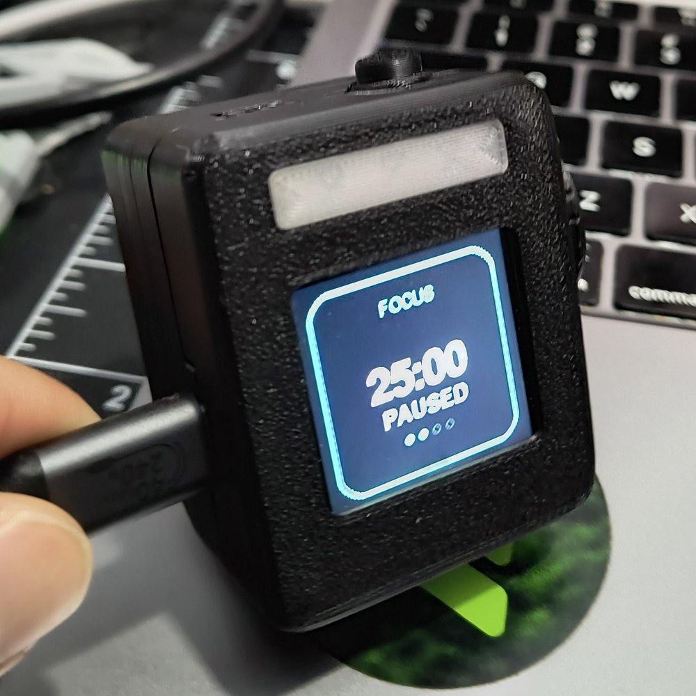

# Tasky User Manual

Firmware version: **2.7.0**

Tasky is a small desk device that keeps your focus sessions, your three tasks for the day, your calendar and your streak in front of you. You operate it with one knob and one button.


- [Quick start](#quick-start)
- [Controls](#controls)
- [Screens](#screens)
- [Focus mode](#focus-mode)
- [Automatic screens](#automatic-screens)
- [WiFi portal and integrations](#wifi-portal-and-integrations)
- [Firmware updates](#firmware-updates)
- [Tasky for Agents](#tasky-for-agents)
- [Factory reset](#factory-reset)
- [Troubleshooting](#troubleshooting)

---

## Quick start

### The easy way: from your computer (recommended)

1. Open **https://tasky-flash.vercel.app** in Chrome or Edge and flash the latest firmware (if your Tasky doesn't have it yet).
2. Scroll to **Set up** and click **Connect Tasky**. Pick Tasky's USB port.
3. Follow the steps: **Wi-Fi → calendar → today's tasks → GitHub → AI → weather**. Every step is optional, and the time zone is set from your computer.
4. That's it. Tasky shows the **Home** screen with the time, weather, what's next and your tasks.

> [!TIP]
> **No internet yet?** Tasky takes the time from your computer during setup (or from your phone when you open the setup page), so the clock is right even before Wi-Fi. Once online, it keeps it exact over NTP.

### From your phone (no computer)

1. **Power it up.** Plug in a USB-C cable. You'll see the Tasky splash screen, a short tour of the controls and then **Home**. The focus timer works offline right away.
2. **Turn on the setup network.** Tasky doesn't broadcast its setup network until you ask it to. Double-press **MODE** to jump to **More**, turn the knob to **Setup (QR)** and press the knob. The screen fills with a QR code.
3. **Join the network.** Scan the QR code with your phone's camera, or join this WiFi network by hand:

   | Network (SSID) | Password                                   |
   | -------------- | ------------------------------------------ |
   | `Tasky`        | Shown on the screen (unique to your Tasky) |

4. **Open the portal.** Most phones open the setup page on their own (captive portal). If yours doesn't, browse to **http://192.168.4.1**.
5. **Enter your WiFi details.** Fill in your home network name, its password and your **UTC offset** (for example `-6`). Then tap **Guardar y Conectar** (Save and connect).
6. **Check that it worked.** On the device, go to **More → Settings**, select **WiFi** and press the knob. The screen should say **Connected** and show the device's IP address on your network.

> [!NOTE]
> The portal pages are currently in Spanish. The [field reference](#portal-fields) below gives the English meaning of every field.

Once Tasky is online it sets its clock over NTP. Your calendar, weather, GitHub and AI agent integrations then start updating in the background.

---

## Controls

| Control                    | Action               | What it does                                                                                       |
| -------------------------- | -------------------- | -------------------------------------------------------------------------------------------------- |
| **Knob**                   | Turn                 | Moves a selection, changes a value or scrolls (depends on the screen)                               |
| **Knob**                   | Short press          | The screen's main action                                                                           |
| **Knob**                   | Long press (≥ 0.9 s) | The screen's secondary action (reset, details, mode menu)                                          |
| **MODE**                   | Single press         | Next screen in the main carousel. From a screen you opened through **More**, it takes you back to **More** |
| **MODE**                   | Double press         | Previous screen in the main carousel (or back to **More**)                                         |
| **MODE**                   | Hold (≥ 1.5 s)       | Switch to the [Ambient](#ambient-idle-screen) idle screen                                          |
| **Knob + MODE**            | Hold both for 3 s    | [Factory reset](#factory-reset)                                                                     |

A single MODE press takes effect about 0.4 s after you let go, because Tasky first waits to see whether a second press follows.

**First boot tour and hints.** A new Tasky starts with a four-step tour: turn the knob, press it, press MODE, done. Each step waits until you do it. Hold MODE to skip. Replay it any time from **More → Tour**. After that, the first three times you open each screen a one-line hint at the bottom says what the knob does there ("Turn: time  Press: start"). It disappears after 3 seconds or as soon as you touch a control. A [factory reset](#factory-reset) brings back both.


### Screen map

MODE moves through the **main carousel** in a loop:

```
Home → Timer → Tasks → Agenda → Stats → More → (back to Home)
```

**More** opens the less frequently used screens:

| More item  | Screen                                   |
| ---------- | ---------------------------------------- |
| Focus      | [Focus mode settings](#focus)            |
| Calendar   | [Month calendar](#calendar)              |
| Streak     | [Activity streak grid](#streak)          |
| Weather    | [Current weather](#weather)              |
| Agent      | [AI agent](#agent)                       |
| Update     | [Allow a firmware upload](#update)       |
| Setup (QR) | [Setup network QR code](#setup-qr)       |
| Settings   | [Device settings](#settings)             |
| Tour       | Replay the first-boot tour               |

---

## Screens

### Home

The first screen, made for a quick glance:

- **Clock** (once the time is synced) and the **date**, with the **weather** next to it
- Your **next event** today
- Today's **open tasks** (the one you're focusing on is in teal)
- A **phrase** that changes every couple of minutes ("Every second counts", "One thing at a time", …)

| Input       | Result                                  |
| ----------- | --------------------------------------- |
| Short press | Start a focus session (opens the Timer) |
| Long press  | Open Tasks                              |
| MODE        | Next screen (Timer)                     |

The clock and phrase update every minute; everything else refreshes every 5 minutes or when new weather arrives.

### Timer



This is a Pomodoro-style timer that alternates between **FOCUS** (work) and **BREAK**.

**What it shows**

- **Label:** FOCUS or BREAK. A small dot next to it means [focus mode](#focus-mode) is active.
- **Time left:** large `MM:SS` digits. **PAUSED** appears below them while the timer is stopped.
- **Progress ring:** traces the edge of the screen and shrinks as time runs out. It is teal above 66% remaining, purple above 25% and red below that.
- **Session dots:** four dots that fill as you complete work sessions today (a 4-session cycle).
- **Task line:** during work, the [task you're focusing on](#tasks).

| Input       | Stopped / paused                                                                                                   | Running         |
| ----------- | ------------------------------------------------------------------------------------------------------------------ | --------------- |
| Turn        | Changes the length of the current phase in 5-minute steps (work: 5–90 min, break: 1–30 min). This also resets the phase | Nothing         |
| Short press | Start                                                                                                              | Pause           |
| Long press  | Reset the current phase                                                                                            | Reset the current phase |

**When a session ends**, the ring turns fully green, the screen shows **WELL DONE** and the light bar blinks. The buzzer also beeps if sound is on. It keeps alerting until you act:

| Input       | Result                                                     |
| ----------- | ---------------------------------------------------------- |
| Short press | Go to the next phase (work → break, break → work)          |
| Long press  | Reset the same phase                                       |
| Leave the Timer screen | Silences the alarm                              |

Each finished **work** session counts toward total focus time and today's sessions. It also feeds your streak and adds minutes to the current task.

### Tasks


You get three task slots plus an **Add task...** row. You enter the task names and descriptions in the [portal](#portal-fields). Next to each task, Tasky shows how many minutes you have focused on it (in teal for the task the timer is tracking).

| Input                       | Result                                                                                          |
| --------------------------- | ----------------------------------------------------------------------------------------------- |
| Turn                        | Move the selection (it wraps around)                                                            |
| Short press on a task       | Toggle done. Marking a task done adds activity to today's streak and stops tracking time on it  |
| Short press on Add task...  | Open [Setup (QR)](#setup-qr) so you can edit tasks in the portal                                |
| Long press on a task        | Open **Task detail**                                                                            |

**Task detail** shows the full title, a status line (**COMPLETED**, **Focused N min** or **IN PROGRESS**) and the description.

- **Short press on an open task:** makes it the timer's current task and jumps to the Timer. Its name then appears on the Timer and its focus minutes are tracked.
- **Any other press:** closes the detail view.

If every slot is empty, the screen shows **No tasks yet – Scan the QR code to add your tasks**.

### Agenda

This screen shows your day at a glance:

- **Today:** up to 3 events with their start times (or "All day"), plus "+N more" if there are others.
- **Tomorrow:** up to 3 events.
- **Notion:** up to 3 tasks with checkboxes. This section appears only when Notion is configured and returned tasks.

| Input       | Result                                                     |
| ----------- | ---------------------------------------------------------- |
| Short press | Refresh the calendar and Notion now (when configured)      |
| Turn / long press | Nothing                                              |

The screen redraws on its own when new calendar data arrives.

### Stats


This screen shows your **total focus time** (all time, in hours and minutes), **sessions today** and **minutes focused today**. It is display-only and has no knob actions.

### More


More is a menu of the remaining screens. Turn the knob to select an item and press it to open the screen. MODE leaves the menu: single press to the Timer, double press to Stats.

### Focus

These are the [focus mode](#focus-mode) settings. The top line shows the current state: **Active now**, **Starts with the timer** or **Off**. The bottom line shows today's sessions and focus minutes.

| Option              | Meaning                                                              |
| ------------------- | -------------------------------------------------------------------- |
| **Auto with timer** | Focus mode turns on while a work session runs. Off disables focus mode completely |
| **Light signal**    | The light bar stays on as a "do not disturb" signal while you focus  |
| **Lock screens**    | MODE can't leave the Timer while you focus                           |

**Turn** to select an option and **short press** to toggle it ON or OFF. All three options are ON by default. Changes are saved immediately.

### Calendar

This is a month grid. Each day is colored by how busy it is, based on your [iCal calendar](#calendar-ical).

| Input             | Result                                                                    |
| ----------------- | ------------------------------------------------------------------------- |
| Turn              | Select a day (1–31, wraps around)                                         |
| Short press       | Show that day's events: time span, title and description                  |
| Any press (while showing a day) | Close the day view                                          |

The footer shows the event count for the selected day, or **No calendar linked** when you haven't set a calendar URL.

### Streak

This is an activity grid covering the last 84 days (6 rows × 14 columns). Each square has an intensity from 0 to 3. Today has a teal border and the cursor has a white border. Below the grid you'll find the current streak (consecutive active days), the total number of active days, your best streak and how full the grid is.

| Input       | Result                                                             |
| ----------- | ------------------------------------------------------------------ |
| Turn        | Move the cursor                                                    |
| Short press | Change the intensity of the selected day (0 → 1 → 2 → 3 → 0). Use this to fix a day by hand |

**How intensity is set.** Choose the streak source in the portal: GitHub only, Tasky only or Combined (default, which keeps the higher of the two).

| Intensity | Tasky sessions that day | GitHub events that day |
| --------- | ----------------------- | ---------------------- |
| 1         | 1–2                     | 1–3                    |
| 2         | 3–4                     | 4–7                    |
| 3         | 5+                      | 8+                     |

Marking a task done also adds +1 intensity to today, up to a maximum of 3.

### Weather

This screen shows the current temperature, "feels like" temperature, humidity, a condition icon and description, and your city. Data comes from [Open-Meteo](https://open-meteo.com) (no API key needed) and refreshes every 30 minutes.

| Input       | Result          |
| ----------- | --------------- |
| Short press | Refresh now     |

If you haven't set a city, the screen shows the clock and the hint **Connect WiFi for weather**.

### Agent

This is an AI coach that gives one short, actionable suggestion at a time, based on your tasks, your timer state, your streak, today's sessions and today's calendar. It needs an [LLM API key](#ai-agent).

**Modes.** Each day the agent picks one of nine modes in rotation (**AUTO**). You can also pin a specific mode:

| Mode      | Gives you                          |
| --------- | ---------------------------------- |
| FOCUS     | A concrete action to move forward  |
| KICKSTART | A tiny step to break the day's inertia |
| TIME      | A tip to use your time better      |
| CLARITY   | A question to help you prioritize  |
| ORDER     | A physical-tidying action          |
| CLOSING   | Something to prepare before ending the day |
| MOVEMENT  | A short exercise routine           |
| GYM       | A gym routine for today            |
| RECIPES   | An easy, affordable recipe         |

| State                 | Input       | Result                                   |
| --------------------- | ----------- | ---------------------------------------- |
| Idle                  | Short press | Ask (shows "Thinking", then the answer)  |
| Idle                  | Long press  | Open **SELECT MODE**                     |
| Thinking              | Short press | Cancel                                   |
| Showing an answer     | Turn        | Scroll                                   |
| Showing an answer     | Any press   | Back to idle                             |
| Error                 | Short press | Back to idle                             |
| SELECT MODE           | Turn / short press | Choose AUTO or a mode / confirm   |
| SELECT MODE           | Long press  | Cancel                                   |

**Good to know**

- Answers are in **Spanish** and limited to about 180 characters.
- Tasky keeps one answer per mode per day. Asking again in the same mode on the same day shows the saved answer without calling the API.
- Requests are capped at **20 per hour** and **100 per day**. When you hit the cap, are offline or the API call fails, Tasky shows a built-in offline tip instead.
- The models used are `claude-haiku-4-5` (Anthropic) or `gpt-4o-mini` (OpenAI).
- Privacy: your task names, timer state, streak numbers, session counts and up to three of today's event titles and times are sent to the provider you choose.

### Update

This screen lets the portal accept a firmware upload. Uploads are **refused unless you allow them here**, so nobody on your network can flash the device without physically touching it.

| Input       | Result                                                    |
| ----------- | --------------------------------------------------------- |
| Short press | Allow uploads for **5 minutes** (shows **READY**, the portal URL and a countdown). Press again to block them right away |

Opening this screen also starts the portal. The URL shown is the device's IP on your WiFi, or `http://192.168.4.1/` plus the setup network credentials when it isn't connected. See [Firmware updates](#firmware-updates).

### Setup (QR)

This screen starts the setup network and shows a full-screen QR code that joins your phone to it (`Tasky` + this device's password, also printed under the QR). **Short press** returns to the Timer.

### Settings

| Item   | Values                       | Notes                                                                  |
| ------ | ---------------------------- | ---------------------------------------------------------------------- |
| Work   | 5–90 min, 5-min steps        | Work session length                                                    |
| Break  | 1–30 min, 5-min steps        | Break length                                                           |
| WiFi   | ON / OFF                     | ON means a network is saved. Green means connected, red means not. Pressing it opens the **WiFi** info screen |
| Bright | 7–100 %, ~10 % steps         | Screen backlight (see the note below)                                  |
| LED    | 0–100 %, ~10 % steps         | Light bar brightness, used for focus light, alarms and alerts          |
| Theme  | DARK / LIGHT                 | Color theme                                                            |

**To change a setting:** turn to select it, short press to edit (the frame turns teal), turn to change the value, then short press to save.

The **WiFi** info screen shows **Connected**, the network name and the IP address (or **Disconnected**), plus the setup network details. Short press returns to Settings.

> [!NOTE]
> On the reference hardware the backlight is switched on/off from a digital pin, so the **Bright** value doesn't visibly dim the screen.

---

## Focus mode

Focus mode is **on whenever a work session is running** and **Auto with timer** is enabled. It turns off automatically when you pause the timer, when the session ends or during breaks.

While focus mode is on:

- **Light bar:** with *Light signal* enabled, the light bar glows steadily at your LED brightness. It tells people around you that you're focusing.
- **Lock:** with *Lock screens* enabled, MODE does nothing on the Timer and the task line briefly shows **Pause to unlock**. Pause the timer (short press) to move around again.
- **Indicator:** a dot appears next to the FOCUS label.

Configure focus mode under **More → Focus**.

---

## Automatic screens

### Ambient (idle screen)

Ambient uses the same layout as [Home](#home). Tasky switches to it in two cases:

- You **hold MODE** for 1.5 s.
- **5 minutes** pass without any input.

It won't switch while a timer is running or a finished-session alarm is waiting, while you're on Update, Setup (QR) or WiFi info, or while you're already on Home. **Any input** (turn, press or MODE) returns you to the screen you were on. That input is used only to wake the screen.

### Meeting alert

When a timed event from your calendar starts **within 5 minutes**, Tasky shows **MEETING** with the minutes remaining (or **Now**), the event title and its time span. Then:

- The light bar blinks for 10 s and the buzzer beeps briefly (if sound is on).
- If a work session is running, it is **paused** and the alert says **Timer paused**.
- Each event triggers only one alert.

Press the knob or MODE to dismiss the alert and return to where you were. Turning the knob doesn't dismiss it. All-day events never trigger alerts.

### Morning brief and day close

These screens use your workday hours (portal fields **Inicio/Fin de jornada**, 9 and 18 by default):

| Notice           | When                                                                 | Shows                                                         |
| ---------------- | -------------------------------------------------------------------- | ------------------------------------------------------------- |
| **GOOD MORNING** | First check during workday hours, once per day                      | Date, today's event count, next event, streak, yesterday's sessions |
| **DAY DONE**     | First check at or after the end hour, once per day                  | Focus minutes today, sessions, tasks done/total, streak, tomorrow's first event (or "Rest well") |

Both notices wait at least 2 minutes after boot, so WiFi and the calendar have time to load. They never interrupt a running or finished session. Press the knob or MODE to dismiss them. Both need the clock to be synced.

---

## WiFi portal and integrations

### Starting the portal

The setup network (`Tasky` + your device's password) and the web portal start the **first time** you open **Setup (QR)**, **Settings → WiFi** or **Update**, or select **Add task...**. They stay on while one of those screens is open, while a phone is connected to the setup network or while an update is allowed, and **turn off by themselves after 10 minutes without activity**. Your home WiFi connection is not affected.

You can reach the portal in two ways:

- On the setup network: **http://192.168.4.1**
- On your home WiFi: **http://&lt;device IP&gt;/** (the IP is shown on the WiFi info and Update screens). Your browser asks for a login: user **`tasky`**, password = the setup-network password shown on the device.

**Saved secrets are never shown.** The WiFi password, calendar URL and API keys appear as empty fields marked **Configurada**. Leave a field empty to keep the saved value, type a new one to replace it, or tick **borrar** to delete it.

> [!WARNING]
> Anyone who can see Tasky's screen can learn its password and change its settings (never read your saved secrets). The page is plain HTTP, so on a shared network the login can be sniffed while you use it; the portal turns off after 10 idle minutes. A factory reset generates a new password.

### Portal fields

Tap **Guardar y Conectar** to save every field at once. Tasky then reconnects to WiFi with the new settings.

| Section (Spanish label)           | Field                          | Meaning                                                              |
| --------------------------------- | ------------------------------ | -------------------------------------------------------------------- |
| Conexion WiFi                     | SSID de tu WiFi / Password     | Your 2.4 GHz network name and password                               |
| Conexion WiFi                     | Zona Horaria (UTC Offset)      | Whole hours, −12 to +14. Daylight saving time isn't applied automatically |
| Tareas de Hoy                     | Tarea 1–3 + Descripcion        | Task names (max 40 characters) and optional descriptions (max 200) |
| Timer Pomodoro                    | Minutos por Sesion             | Work session length, 5–90 min                                        |
| Timer Pomodoro                    | Inicio / Fin de jornada        | Workday start and end hour (0–23) for the morning brief and day close |
| Integraciones                     | GitHub Username                | See [GitHub](#github)                                                |
| Integraciones                     | Calendar URL (iCal)            | See [Calendar](#calendar-ical)                                       |
| Streak                            | Fuente del Streak              | Solo GitHub / Solo Tasky / Combinado                                 |
| Weather Widget                    | Ciudad, Latitud, Longitud, Unidades | See [Weather](#weather-1)                                       |
| AI Agent                          | Proveedor de IA, API Key       | See [AI agent](#ai-agent)                                            |

> [!NOTE]
> When you change a task's name, that slot starts again: not done, zero focus minutes. Tasks whose names you don't change keep their checkmark.

The break length isn't in the portal. Set it on the device under **More → Settings → Break**.

### Integrations

All integrations are optional and need WiFi. Most also need the clock to be synced.

| Integration | What you need                                                   | Refresh                    | Where it shows               |
| ----------- | --------------------------------------------------------------- | -------------------------- | ---------------------------- |
| Calendar    | Secret iCal address                                             | 10 s after boot, then every 15 min | Agenda, Calendar, Ambient, alerts, briefs |
| GitHub      | Username (token optional, build-time only)                      | 10 s after boot, then every 30 min | Streak                       |
| Weather     | City **or** latitude/longitude                                  | 10 s after boot, then every 30 min | Weather, Ambient             |
| AI agent    | Anthropic or OpenAI API key                                     | On demand                  | Agent                        |
| Notion      | Integration token + database ID (build-time in standard firmware) | Every 10 min             | Agenda                       |

#### Calendar (iCal)

1. In Google Calendar, open **Settings**, then select your calendar in the left menu.
2. Under **Integrate calendar**, copy **Secret address in iCal format**.
3. Paste it into **Calendar URL (iCal)**.

Any calendar app that publishes a standard `.ics` URL works too.

Limits:

- Only events in the **current month** are loaded. Up to 20 are kept, including 5 for today.
- Daily, weekly and monthly recurring events are expanded.
- Times in UTC are converted with your UTC offset. Times that carry a time-zone ID are treated as local time.

#### GitHub

Enter your **GitHub username**. Tasky reads your 100 most recent public events and counts how many happened on each of the last 30 days. Those counts feed the [Streak](#streak) when the streak source is GitHub or Combined.

An optional token (for higher API rate limits) can only be set at build time through `SECRET_GITHUB_TOKEN` in `config_secrets.h`. The portal doesn't have a field for it.

#### Weather

Enter a **city** name. Tasky looks up its coordinates through Open-Meteo geocoding. You can also enter **latitude/longitude** directly. Leave them at `0` to use the city lookup. Changing the city clears the old coordinates. Choose Celsius or Fahrenheit under **Unidades**.

#### AI agent

1. Create an API key:
   - **Anthropic:** console.anthropic.com → Settings → API keys (the key starts with `sk-ant-`)
   - **OpenAI:** platform.openai.com → API keys (the key starts with `sk-`)
2. In the portal, choose the provider under **Proveedor de IA** and paste the key into **API Key**.

You pay your provider for usage directly.

#### Notion

Tasky reads up to 5 pages from one Notion database. For each page it uses the title, the first checkbox property (done), the first text property (description) and the first date property.

To set it up:

1. Create an integration at notion.so/my-integrations and copy its token.
2. Share your task database with the integration.
3. Copy the 32-character database ID from the database URL.

In the standard firmware the Notion fields are hidden from the portal. To use Notion, do one of the following before building (see [BUILDING.md](BUILDING.md)):

- Set `SECRET_NOTION_API_KEY` and `SECRET_NOTION_DATABASE_ID` in `config_secrets.h`.
- Build with `TASKY_MODE_DEV 1`, which shows the Notion fields in the portal.

#### Experimental: Spotify and Firebase

Spotify (now playing and controls) and Firebase (cloud sync of stats) exist in the source but are **compiled out by default** (`FEATURE_SPOTIFY 0` and `FEATURE_FIREBASE 0` in `config_features.h`). They are experimental and unsupported in release builds.

---

## Firmware updates

You can update Tasky in two ways.

### Option A: web flasher (USB, recommended)

1. Open **https://tasky-flash.vercel.app** in a Chromium-based browser such as Chrome or Edge (it needs Web Serial).
2. Connect Tasky over USB-C and follow the steps on the page.

The flasher writes the bootloader, partition table and app, so it also works on a blank board or one with broken firmware. It leaves the settings area alone: your WiFi, integrations, tasks and stats survive an update.

> [!TIP]
> ESP Web Tools asks whether to **erase the device** first. Choose erase for a clean install, or when moving a board from other firmware; you'll then redo the [Quick start](#quick-start) setup.

If the board isn't detected, see [Can't enter the bootloader](#cant-enter-the-bootloader).

### Option B: over WiFi from the portal

1. On the device, open **More → Update** and press the knob. The screen shows **READY**, the URL and a 5-minute countdown.
2. Open that URL in a browser on the same network, or on the setup network.
3. Scroll to **Firmware Update**, choose the `.bin` file and click **Actualizar Firmware**.
4. Watch the progress bar. When the upload finishes, the device reboots into the new version.

Use the **app-only image**: `tasky-<board>-vX.Y.Z-ota.bin` from the [latest release](https://github.com/arampersand/tasky/releases/latest), or `tasky-<env>-app.bin` from your own build (see [BUILDING.md](BUILDING.md)). Don't use the full `tasky-<board>-vX.Y.Z.bin` image; that one is for flashing at address `0x0` over USB.

If the upload is refused with **"Enable Update on the Tasky first (More > Update)"**, the 5-minute window wasn't open or has expired. Open it again on the device and retry.

The current version is shown on the Update screen and in the portal.

---

## Tasky for Agents

The **Tasky for Agents** firmware (pick it in the web flasher) turns Tasky into a companion for your computer. It keeps Home, the focus timer, tasks, agenda and weather, and replaces the AI chat and Notion with two screens:

```
Home → Agents → Controls → Timer → Tasks → Agenda → More
```

### Agents

Shows the AI coding agents running on your computer (for example Claude Code sessions), reported over USB by the [companion hooks](../companion/README.md).

| What you see | Meaning |
|---|---|
| Teal ring, "working" | The agent is busy |
| **Orange dot, "waiting"** | The agent needs your approval or input. The **light bar breathes** and Tasky beeps once (not during a focus session); Home says "1 agent needs you" |
| Green ring, "done" | The agent finished its turn |

| Input | Result |
|---|---|
| Turn | Select a session (its last message shows at the bottom) |
| Short press | Acknowledge: the light stops breathing for that session |
| Long press | Dismiss the session |

Tasky keeps up to 4 sessions and forgets ones with no news for 2 hours.

### Controls (Bluetooth)

The knob becomes a dial for your computer. **Pair once:** on your computer open Bluetooth settings and connect to **Tasky** (it shows up as a keyboard).

| Mode | Turn | Short press |
|---|---|---|
| **Volume** | Volume up / down | Mute |
| **Brightness** | Screen brightness up / down | — |
| **Media** | Next / previous track | Play / pause |
| **Shortcuts** | Pick: Spotlight, Voice / Siri, Screenshot, Mission Control, Lock screen | Run it |

**Long press** switches mode. Shortcuts are macOS key combos; see [CUSTOMIZING.md](CUSTOMIZING.md#shortcuts-tasky-for-agents) to change them.

## Factory reset

Hold the **knob and MODE together for 3 seconds**. The screen shows **RESET**, all settings and data are erased, and the device restarts. Erased items include WiFi, integrations, tasks, timer settings, streak and stats.

---

## Troubleshooting

| Problem | Fix |
| ------- | --- |
| **The knob turns the wrong way** | Swap the encoder's CLK and DT wires, or swap the `ENCODER_CLK` / `ENCODER_DT` pin definitions in `config_hardware.h` and rebuild |
| **Noisy or shifted strip at the top of the screen** | Your panel needs a RAM offset. Set `ROW_OFFSET` in `config_hardware.h` to `40` or `80` (try `COL_OFFSET` too) and rebuild. Setting `DISPLAY_BRINGUP 1` runs a test pattern that cycles through offsets 0, 20 and 80. Set it back to `0` afterwards |
| <a id="cant-enter-the-bootloader"></a>**Can't enter the bootloader / the flasher doesn't see the board** | Unplug USB. Hold the XIAO's **BOOT** button while plugging the cable back in, then release it and connect again. Try a different USB-C cable (some are charge-only) |
| **The setup network doesn't appear** | It only starts after you open **Setup (QR)**, **Settings → WiFi** or **Update** (see [Starting the portal](#starting-the-portal)) |
| **The portal page doesn't open** | Make sure you're joined to `Tasky`. Browse to **http://192.168.4.1** by hand. Turn off mobile data on your phone so it doesn't bypass the setup network |
| **WiFi shows "Failed"** | Tasky gives up after 15 s and doesn't retry by itself. Check the network name and password (2.4 GHz networks only), then save the portal form again or restart the device |
| **The clock shows `--:--`, or alerts and briefs never appear** | Time comes from NTP (`pool.ntp.org`) and needs WiFi. Check that WiFi is connected. If the time is off by whole hours, fix the UTC offset in the portal. Daylight saving time isn't automatic, so update the offset when DST changes |
| **The calendar is empty** | Check that the URL is the *secret iCal* address and that the clock is synced. Press the knob on Agenda to refresh. Only the current month is loaded |
| **The agent says "Set API key in portal"** | Enter a provider and API key in the portal |
| **No sound** | Sound is on by default. Check the buzzer wiring ([HARDWARE.md](HARDWARE.md)) |
| **Something else** | Open a serial monitor at **115200 baud** (`pio device monitor`) and watch the boot log and the `[Cal]`, `[GH]`, `[Notion]`, `[LLM]` and `[OTA]` messages |
